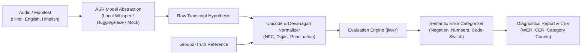

# BhashaSwitch: Hindi-English Code-Switching Speech Recognition Evaluation

[](https://www.python.org/)
[](LICENSE)
[](tests/)

> **One-minute summary**: BhashaSwitch is a speech recognition evaluation and error-diagnostic benchmark designed for real-world multilingual conversational AI. Standard ASR systems often perform reliably on pure Hindi or pure English but degrade significantly during intra-sentential **code-switching** (Hinglish), numeral recognition, proper nouns, and negation handling. BhashaSwitch provides automated Unicode/Devanagari normalization, WER/CER calculation, and granular semantic failure detection.

---

## 1. Research Motivation & Failure Taxonomy

Conventional speech-to-text benchmarks report aggregate Word Error Rate (WER). However, aggregate WER obscures critical failure modes in Indian-language voice interfaces:
1. **Negation Dropping**: Dropping *"नहीं"* / *"do not"* completely inverts the speaker's meaning (e.g., executing an unconfirmed transfer).
2. **Numeral & Alphanumeric Errors**: Mishearing OTPs, timestamps, flight numbers, or amounts.
3. **Orthographic vs. Meaning-Changing Variations**: Distinguishing acceptable romanized transliteration differences (*pe* vs. *par*) from genuine transcription failures.

---

## 2. Architecture



---

## 3. Installation

Requires Python 3.11+.

```bash
# Clone the repository
git clone https://github.com/Naman-the-Ace/bhashaswitch-asr.git
cd bhashaswitch-asr

# Install in editable mode
pip install -e .
```

---

## 4. Quickstart & CLI Usage

### Normalize Multilingual Text
```bash
bhashaswitch normalize "नमस्ते दुनिया! ट्रेन नंबर ९८७ आ रही है।"
```
*Output:*
```text
Raw:        नमस्ते दुनिया! ट्रेन नंबर ९८७ आ रही है।
Normalized: नमस्ते दुनिया ट्रेन नंबर 987 आ रही है
```

### Run Benchmark Evaluation
```bash
bhashaswitch benchmark manifest.example.csv --output reports/benchmark_results.csv
```
*Output:*
```text
Running benchmark on manifest: manifest.example.csv

Benchmark Evaluation Results:
 clip_id    language    wer    cer  number_error  negation_error
clip_001       hindi 0.0000 0.0000         False           False
clip_002       hindi 0.1667 0.2174         False            True
clip_003     english 0.0000 0.0000         False           False
clip_004     english 0.3333 0.1795         False            True
clip_005 code_switch 0.0000 0.0000         False           False
clip_006 code_switch 0.1429 0.1351         False           False
clip_007 code_switch 0.1250 0.0488         False           False
clip_008 code_switch 0.1250 0.0222          True           False

==================================================
Overall WER: 11.16% | CER: 7.54%
Number Errors: 1 | Negation Errors: 2
```

---

## 5. Empirical Results

See full research report: [reports/experiment_report.md](reports/experiment_report.md).

| Language Category | Samples | Mean WER | Mean CER | Negation Errors | Numeral Errors |
|:---|:---:|:---:|:---:|:---:|:---:|
| Monolingual Hindi | 2 | 8.33% | 10.87% | 1 | 0 |
| Monolingual English | 2 | 16.67% | 8.97% | 1 | 0 |
| Hinglish Code-Switch | 4 | 9.82% | 5.15% | 0 | 1 |
| **Overall** | **8** | **11.16%** | **7.54%** | **2** | **1** |

---

## 6. Upstream Attribution & Original Work

- **Inspiration**: Code-switching evaluation challenges observed across open-source Indian ASR benchmarks.
- **Original Implementation**: Complete Unicode and Devanagari normalizer, semantic error classifier (negation and number tracking), mock and local model abstraction, benchmark runner, and reporting tool.

---

## 7. Running Tests

```bash
pytest -v
```
All unit tests run deterministically on CPU in under 1 second.
